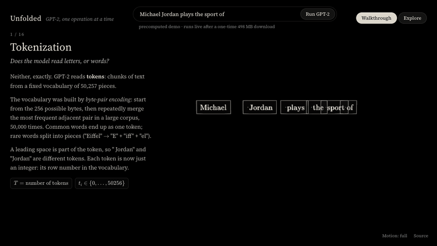

# Unfolded

**GPT-2 small, running in your browser, filmed one operation at a time.**



Unfolded is an interactive 3D explainer of how a decoder-only transformer turns text into a
next-token prediction. Type any sentence: the real GPT-2 small (124M parameters) runs in your
browser, and every number on screen is an actual activation from that forward pass: token ids,
embeddings, every residual stream, LayerNorm outputs, Q/K/V per head, raw and masked scores,
attention weights, MLP pre- and post-activations, logits and probabilities. Every tensor is labelled
with its true shape.

## Two modes

- **Walkthrough**: 17 scroll-driven steps (arrow keys work too) from tokenization to training.
  Each step answers the question a first-time learner actually asks ("how does an integer become
  something a network can compute with?") with a choreographed scene, short prose and KaTeX math.
- **Explore**: orbit the whole 12-block tower, click a block to fly to it, scrub the residual
  stream through the layers, inspect any of the 144 attention heads, and sample next tokens with
  temperature, top-k and top-p.

The site opens instantly on a precomputed demo prompt ("Michael Jordan plays the sport of" →
" basketball", 13.5%). Pressing **Run GPT-2** streams the weights once (498 MB from Hugging Face,
cached in the browser afterwards) and from then on everything is computed live.

## What the walkthrough covers

| # | Step | What you see |
|---|---|---|
| 1 | Tokenization | the prompt splits into byte-level BPE tokens, each gets its id |
| 2 | Embedding matrix | each id lights its row of the 50,257 × 768 slab; the row flies out as a column |
| 3 | Positional embeddings | rows of W_P fly in and are added entry by entry |
| 4 | Residual stream | columns stretch into rails through all 12 blocks; brightness = real ‖x‖ |
| 5 | LayerNorm | all 768 entries centered and rescaled, with the real μ and σ |
| 6 | Q, K, V | three real matrix–vector products, then the split into 12 heads of 64 |
| 7 | Attention scores | q · k as paired products summing to one score; ‖a‖‖b‖cos θ on the side |
| 8 | Scale, mask, softmax | ÷√64, the upper triangle to −∞, rows normalised to sum to 1 |
| 9 | Weighted sum of values | value vectors flow into each token in proportion to its weights |
| 10 | Twelve heads, W_O | the real patterns of all 12 heads, concatenation, output projection, residual add |
| 11 | MLP | 768 → 3,072 neurons, GELU (which neurons fire), → 768, residual add |
| 12 | Many repetitions | the tower of 12 blocks with each block's real attention patterns |
| 13 | Unembedding | LN_f, the tied W_Eᵀ, 50,257 logits |
| 14 | Sampling | softmax, temperature, top-k, top-p, the draw |
| 15 | Autoregression | the new token runs through the tower while cached keys and values are reused |
| 16 | Training | every position predicts the next token at once; the loss is the mean −log p |

## How it works

```
src/model/       pure TypeScript, no DOM (runs in a Web Worker and in Node)
  tokenizer.ts   GPT-2 byte-level BPE, identical ids to Hugging Face
  gpt2.ts        forward pass that keeps every intermediate; KV cache; trace merging
  webgpu.ts      WGSL matmul kernels for the linear layers and the unembedding
  safetensors.ts header parsing and HTTP Range planning (skips the 48 MB of mask buffers)
  sample.ts      temperature / top-k / top-p / seeded sampling
  trace.ts       the SceneTrace the visuals read, plus a float16 binary codec for the demo
src/worker/      streams weights into one buffer (zero-copy tensor views), runs the model
src/scene/       React Three Fiber scenes; one file per walkthrough step
  glyphs/        an instanced glyph renderer: one draw call per tensor, thousands of digits in flight
  primitives/    glass slabs, bracketed columns, matrix slabs, the 12-block tower, DOM math labels
src/story/       step prose and the camera path
```

- **Real model.** The forward pass is written from scratch so every tensor is available. It runs on
  WebGPU when present (~0.4 s for a short prompt on an M-series laptop) and falls back to a CPU
  kernel (~0.9 s). Generation uses a KV cache; the trace of a cached step is merged into the full
  trace, and a test checks the result equals a full recompute.
- **Verified against PyTorch.** `scripts/export_fixtures.py` computes every intermediate with the
  Hugging Face model for three prompts (anchored to `model(input_ids).logits`); the TypeScript tests
  compare embeddings, all 13 residual streams, every intermediate of layers 1, 6 and 12, the logits
  and the top-10 next tokens. The tokenizer matches Hugging Face's ids exactly on 13 strings
  including unicode, emoji, contractions, whitespace runs and `<|endoftext|>`.
- **Choreography as pure functions.** Every animation is a function of scroll progress, so
  scrolling backwards replays it exactly and the logic is unit-testable. Numbers fly on the GPU: each
  glyph instance carries a source position, a target and a delay window.
- **Performance.** 60 fps on an M-series laptop: instanced glyphs, one glass shader with Fresnel
  rims instead of physical transmission, DOM labels projected once per frame.

## Running it

```bash
npm install
npm run dev                  # http://localhost:5173, uses the precomputed demo until you press Run

# tests (need the weights locally: ~550 MB)
pip install huggingface_hub && npm run weights
npm test                     # tokenizer, forward pass vs PyTorch, KV cache, sampling, story/camera

# regenerate the fixtures (needs torch + transformers) and the demo trace
npm run fixtures
npm run demo -- "Michael Jordan plays the sport of"

# screenshots of walkthrough positions (dev server running)
npm run shots -- 2.3 2.6 2.97 --url http://localhost:5173
```

In development the app loads weights from `./weights` through a Range-capable dev middleware; in
production it fetches them from Hugging Face (`VITE_WEIGHTS_URL` overrides the URL). `?cpu` forces
the CPU backend; `?s=4.5` jumps to a story position; `?mode=explore` opens explore mode.

## Deploying

`vercel.json` is included: `npm run build` produces a static site in `dist/` (≈6 MB, of which 1.6 MB is
the demo trace). The weights are never bundled.

## Accessibility

`prefers-reduced-motion` (or the Motion toggle) shows each step's finished state with crossfades only.
On narrow screens the story becomes a bottom sheet over a lighter render.

## Credits

Visual inspiration from 3D transformer explainer videos, Transformer Explainer (Polo Club) and
bbycroft's LLM visualisation; no code or assets are shared with them. Weights: OpenAI GPT-2 via
Hugging Face (`openai-community/gpt2`). Math typesetting: KaTeX.

MIT licensed.
